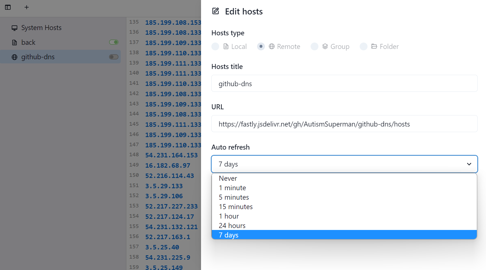

# github-dns
**使用 github action 定时解析 github 最新的 dns 解析**。

没有kx上网是真的麻烦。

**如何使用**：

把 `host` 信息对应加入到 `hosts` 文件中即可

- Linux/Mac 系统：`/etc/hosts`  
- Windows 系统：`C:\Windows\System32\drivers\etc\hosts`  
- Android（安卓）系统：`/system/etc/hosts`

**推荐工具** [SwitchHosts](https://github.com/oldj/SwitchHosts)

使用 SwitchHosts 中的 **远程功能**

网址为  `https://fastly.jsdelivr.net/gh/AutismSuperman/github-dns/hosts`




# update 2026-11-09 21:54:57
```
140.82.114.4                  github.com
192.0.66.2                    github.blog
140.82.113.30                 githubapp.com
140.82.112.30                 githubapp.com
140.82.114.30                 githubapp.com
140.82.114.29                 githubapp.com
140.82.112.29                 githubapp.com
140.82.113.29                 githubapp.com
140.82.113.6                  api.github.com
185.199.108.133               raw.github.com
185.199.110.133               raw.github.com
185.199.109.133               raw.github.com
185.199.111.133               raw.github.com
140.82.112.3                  gist.github.com
140.82.112.4                  octocaptcha.com
185.199.110.133               help.github.com
185.199.108.133               help.github.com
185.199.111.133               help.github.com
185.199.109.133               help.github.com
140.82.114.25                 live.github.com
140.82.114.17                 github.community
185.199.109.153               githubstatus.com
185.199.111.153               githubstatus.com
185.199.110.153               githubstatus.com
185.199.108.153               githubstatus.com
185.199.111.153               pages.github.com
185.199.109.153               pages.github.com
185.199.110.153               pages.github.com
185.199.108.153               pages.github.com
140.82.113.17                 status.github.com
140.82.112.14                 uploads.github.com
140.82.114.10                 nodeload.github.com
185.199.109.153               training.github.com
185.199.110.153               training.github.com
185.199.108.153               training.github.com
185.199.111.153               training.github.com
140.82.112.10                 codeload.github.com
185.199.111.215               github.githubassets.com
185.199.108.215               github.githubassets.com
185.199.109.215               github.githubassets.com
185.199.110.215               github.githubassets.com
185.199.111.133               raw.githubusercontent.com
185.199.108.133               raw.githubusercontent.com
185.199.109.133               raw.githubusercontent.com
185.199.110.133               raw.githubusercontent.com
185.199.108.133               gist.githubusercontent.com
185.199.109.133               gist.githubusercontent.com
185.199.111.133               gist.githubusercontent.com
185.199.110.133               gist.githubusercontent.com
185.199.108.133               camo.githubusercontent.com
185.199.109.133               camo.githubusercontent.com
185.199.110.133               camo.githubusercontent.com
185.199.111.133               camo.githubusercontent.com
185.199.108.133               cloud.githubusercontent.com
185.199.111.133               cloud.githubusercontent.com
185.199.110.133               cloud.githubusercontent.com
185.199.109.133               cloud.githubusercontent.com
185.199.109.133               media.githubusercontent.com
185.199.111.133               media.githubusercontent.com
185.199.108.133               media.githubusercontent.com
185.199.110.133               media.githubusercontent.com
16.15.213.147                 github-com.s3.amazonaws.com
52.216.57.34                  github-com.s3.amazonaws.com
52.216.57.226                 github-com.s3.amazonaws.com
16.15.247.33                  github-com.s3.amazonaws.com
16.15.207.247                 github-com.s3.amazonaws.com
52.217.134.226                github-com.s3.amazonaws.com
16.15.183.34                  github-com.s3.amazonaws.com
16.182.74.34                  github-com.s3.amazonaws.com
151.101.193.194               github.global.ssl.fastly.net
151.101.129.194               github.global.ssl.fastly.net
151.101.65.194                github.global.ssl.fastly.net
151.101.1.194                 github.global.ssl.fastly.net
185.199.109.133               desktop.githubusercontent.com
185.199.108.133               desktop.githubusercontent.com
185.199.111.133               desktop.githubusercontent.com
185.199.110.133               desktop.githubusercontent.com
54.231.201.178                github-cloud.s3.amazonaws.com
52.217.200.234                github-cloud.s3.amazonaws.com
16.15.213.251                 github-cloud.s3.amazonaws.com
16.182.38.106                 github-cloud.s3.amazonaws.com
16.15.183.55                  github-cloud.s3.amazonaws.com
52.217.223.2                  github-cloud.s3.amazonaws.com
52.217.206.10                 github-cloud.s3.amazonaws.com
52.217.40.8                   github-cloud.s3.amazonaws.com
185.199.109.133               avatars.githubusercontent.com
185.199.110.133               avatars.githubusercontent.com
185.199.108.133               avatars.githubusercontent.com
185.199.111.133               avatars.githubusercontent.com
185.199.109.133               favicons.githubusercontent.com
185.199.111.133               favicons.githubusercontent.com
185.199.108.133               favicons.githubusercontent.com
185.199.110.133               favicons.githubusercontent.com
185.199.111.133               avatars0.githubusercontent.com
185.199.108.133               avatars0.githubusercontent.com
185.199.109.133               avatars0.githubusercontent.com
185.199.110.133               avatars0.githubusercontent.com
185.199.108.133               avatars1.githubusercontent.com
185.199.110.133               avatars1.githubusercontent.com
185.199.111.133               avatars1.githubusercontent.com
185.199.109.133               avatars1.githubusercontent.com
185.199.109.133               avatars2.githubusercontent.com
185.199.110.133               avatars2.githubusercontent.com
185.199.111.133               avatars2.githubusercontent.com
185.199.108.133               avatars2.githubusercontent.com
185.199.109.133               avatars3.githubusercontent.com
185.199.111.133               avatars3.githubusercontent.com
185.199.108.133               avatars3.githubusercontent.com
185.199.110.133               avatars3.githubusercontent.com
185.199.108.133               avatars4.githubusercontent.com
185.199.110.133               avatars4.githubusercontent.com
185.199.109.133               avatars4.githubusercontent.com
185.199.111.133               avatars4.githubusercontent.com
185.199.111.133               avatars5.githubusercontent.com
185.199.110.133               avatars5.githubusercontent.com
185.199.109.133               avatars5.githubusercontent.com
185.199.108.133               avatars5.githubusercontent.com
185.199.110.133               avatars6.githubusercontent.com
185.199.111.133               avatars6.githubusercontent.com
185.199.108.133               avatars6.githubusercontent.com
185.199.109.133               avatars6.githubusercontent.com
185.199.111.133               avatars7.githubusercontent.com
185.199.109.133               avatars7.githubusercontent.com
185.199.110.133               avatars7.githubusercontent.com
185.199.108.133               avatars7.githubusercontent.com
185.199.110.133               avatars8.githubusercontent.com
185.199.109.133               avatars8.githubusercontent.com
185.199.111.133               avatars8.githubusercontent.com
185.199.108.133               avatars8.githubusercontent.com
185.199.108.153               customer-stories-feed.github.com
185.199.111.153               customer-stories-feed.github.com
185.199.110.153               customer-stories-feed.github.com
185.199.109.153               customer-stories-feed.github.com
185.199.108.133               user-images.githubusercontent.com
185.199.110.133               user-images.githubusercontent.com
185.199.109.133               user-images.githubusercontent.com
185.199.111.133               user-images.githubusercontent.com
185.199.110.133               repository-images.githubusercontent.com
185.199.108.133               repository-images.githubusercontent.com
185.199.109.133               repository-images.githubusercontent.com
185.199.111.133               repository-images.githubusercontent.com
185.199.110.133               marketplace-screenshots.githubusercontent.com
185.199.111.133               marketplace-screenshots.githubusercontent.com
185.199.109.133               marketplace-screenshots.githubusercontent.com
185.199.108.133               marketplace-screenshots.githubusercontent.com
52.217.80.24                  github-production-user-asset-6210df.s3.amazonaws.com
52.216.24.184                 github-production-user-asset-6210df.s3.amazonaws.com
16.15.191.185                 github-production-user-asset-6210df.s3.amazonaws.com
54.231.201.186                github-production-user-asset-6210df.s3.amazonaws.com
16.15.191.30                  github-production-user-asset-6210df.s3.amazonaws.com
16.15.245.116                 github-production-user-asset-6210df.s3.amazonaws.com
52.217.203.18                 github-production-user-asset-6210df.s3.amazonaws.com
16.182.24.82                  github-production-user-asset-6210df.s3.amazonaws.com
16.15.228.190                 github-production-release-asset-2e65be.s3.amazonaws.com
52.217.115.130                github-production-release-asset-2e65be.s3.amazonaws.com
16.15.213.64                  github-production-release-asset-2e65be.s3.amazonaws.com
52.217.197.58                 github-production-release-asset-2e65be.s3.amazonaws.com
16.15.253.118                 github-production-release-asset-2e65be.s3.amazonaws.com
16.15.237.39                  github-production-release-asset-2e65be.s3.amazonaws.com
52.216.50.34                  github-production-release-asset-2e65be.s3.amazonaws.com
16.15.229.158                 github-production-release-asset-2e65be.s3.amazonaws.com
54.231.204.218                github-production-repository-file-5c1aeb.s3.amazonaws.com
16.15.228.33                  github-production-repository-file-5c1aeb.s3.amazonaws.com
16.15.236.61                  github-production-repository-file-5c1aeb.s3.amazonaws.com
16.15.238.195                 github-production-repository-file-5c1aeb.s3.amazonaws.com
16.15.244.227                 github-production-repository-file-5c1aeb.s3.amazonaws.com
52.217.93.0                   github-production-repository-file-5c1aeb.s3.amazonaws.com
16.15.255.45                  github-production-repository-file-5c1aeb.s3.amazonaws.com
16.15.236.249                 github-production-repository-file-5c1aeb.s3.amazonaws.com
```